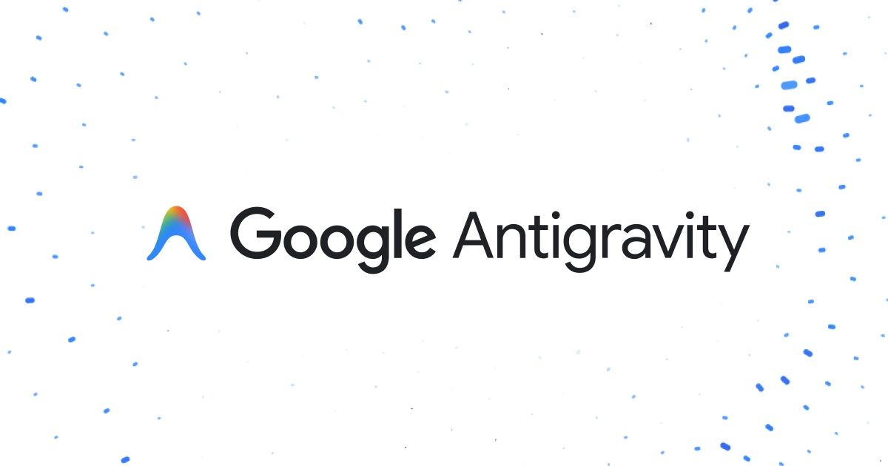

2026年11月3日、Antigravity は「PCを閉じても働く」「声で頼める」エージェントになり始めました。

## 1. はじめに

エージェントに長い作業を頼んでノートPCを閉じると、作業も止まってしまいます。許可ダイアログが出れば、席に戻ってクリックするまで進みません。

今回の目玉は2つです。実行場所をクラウドへ移す Remote Agents と、声で対話する Voice Mode です。

## 2. 主な機能

> - Remote Agents：実行場所がクラウドになり、PCを閉じても動きます（Pro / Ultra 向け、段階的提供）
> - Voice Mode：Gemini Live で声のまま頼めます。許可にも声で答えます（段階的提供）
> - Jupyter ノートブックのビューア
> - Automations 画面の刷新、内蔵ブラウザのダウンロード・履歴対応
> - Marketplace へのパートナープラグイン追加（Canva、Figma など7種）

出典は公式の [Changelog](https://antigravity.google/docs/changelog)（2026年11月3日分）です。

## 3. Remote Agents：PCを閉じても動きます

クラウドプロジェクトの会話は、自分のPCではなく、Google が管理する隔離環境で実行されます。ブラウザを閉じても、ノートPCをスリープさせても、作業は続きます。

材料は[リソース](https://antigravity.google/docs/remote-agents)として渡します。GitHub リポジトリ、Google Drive のファイル、アップロードしたファイルです。

対象は Google AI Pro と Ultra の契約者です。段階的に提供が始まっています。

### よくある勘違い

> - 誤解：自分のPCを外出先から遠隔操作する機能です
> - 正解：それは別の Remote Control の役割です。Remote Agents は実行環境そのものがクラウドにあります
> - つまり：手元のPCは入口だけです。リポジトリ単位の作業を預ける使い方に向きます

## 4. Voice Mode：声で頼めます

Voice Mode は [Gemini Live](https://antigravity.google/docs/voice-mode) を使った音声対話です。空のメッセージボックスにあるボタンから始まります。

声でタスクを渡せます。作業の途中でも、声で指示を変えられます。許可も、クリックではなく声で答えます。声は9種類から選べます。

音声入力とは別物です。音声入力は「話した内容が文字になる」だけです。Voice Mode は会話そのものが音声で進み、作業内容は画面に表示されます。

## 5. そのほかの変更

- Jupyter ノートブック（`.ipynb`）がアプリ内で開けます。ただしビューアのみで、実行はできません
- Automations 画面は Scheduled、Always on、Paused のリストに変わりました。次回と前回の実行時刻が見えます
- 内蔵ブラウザは、ダウンロードの自動保存と、閲覧履歴からの候補表示に対応しました
- Marketplace に Canva、Figma、Linear、Notion、Stripe、Supabase、Vercel のプラグインが加わりました

同じ日、DeepMind が創薬向けの [Cheminformatics Skills](https://deepmind.google/blog/agentic-cheminformatics-with-google-antigravity/) を公開しました。Science プラグイン経由で、化合物検索や分子設計の提案ができます。

## 6. プランと料金

無料枠はローカル実行が中心です。Remote Agents のような新機能は、有料プラン側から提供されます。価格は Google AI プラン自体の米国価格です（[Plans](https://antigravity.google/docs/plans)／[料金ページ](https://antigravity.google/pricing)）。

| プラン | 月額（米国） | 利用枠 |
| --- | --- | --- |
| Free | $0 | 週単位で回復する枠。Gemini モデルが中心です |
| Google AI Pro | $19.99 | 5時間ごとに回復します（週次上限まで）。Claude Sonnet 5.5 / Opus 5.5 も使えます（試用契約を除く） |
| Google AI Ultra | $99.99 / $199.99 | Pro の5倍 / 20倍の枠です |

## 7. 注意点

- Voice Mode と Remote Agents は段階的提供中です。アップデートしても、まだ表示されないことがあります
- Remote Agents は有料プランの個人アカウントが前提です
- 利用枠はエージェントの作業量に連動します。具体的な数値は公表されていません

## 8. まとめ

軸は2つです。実行場所がクラウドへ移る「非同期化」と、入力が声へ広がる「ハンズフリー化」です。

エージェントは「席にいる間だけ働く道具」から「預けておける相手」に近づきました。

