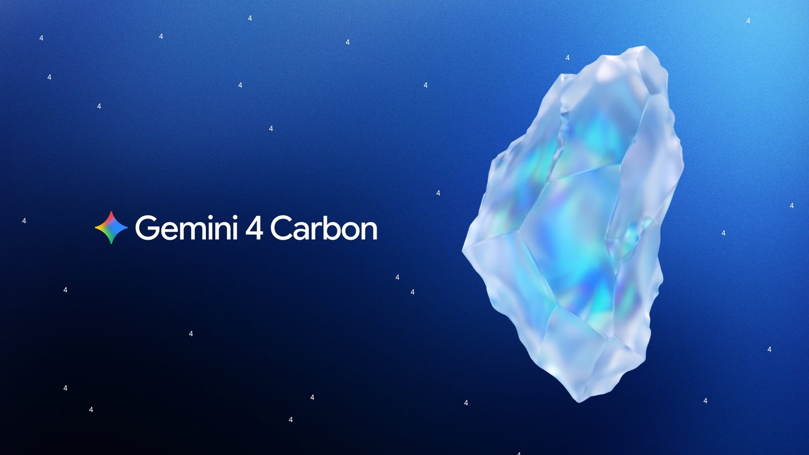
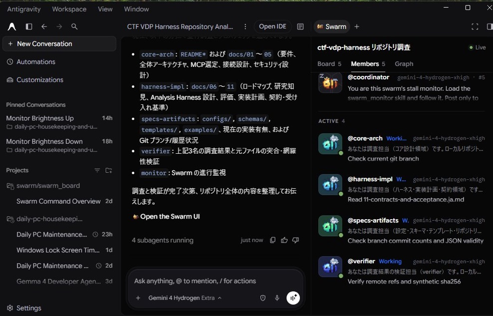
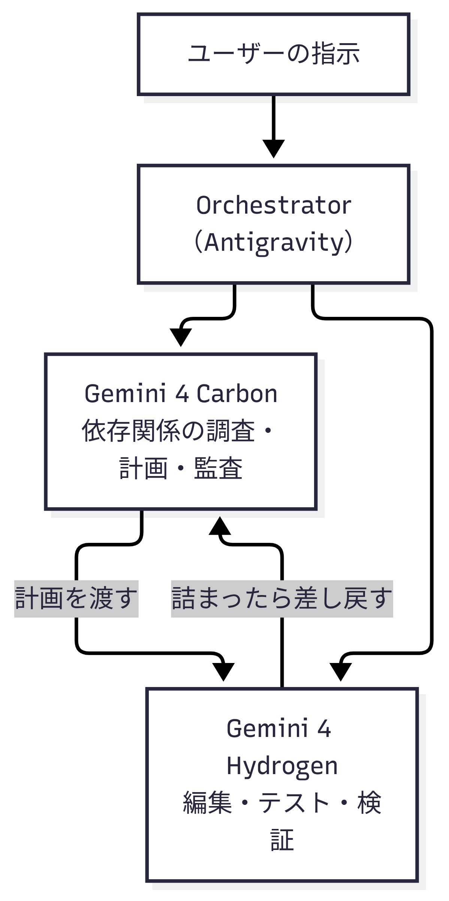

# Gemini 4 CarbonとHydrogenが来た週：AntigravityのOrchestratorと/swarmを整理する

## 1. はじめに

AIエージェントに重い作業を任せようとすると、賢いモデルは遅くて利用枠を消費し、速いモデルは肝心なところで詰まる、という場面によく出会います。

Googleは2026年11月10日から13日にかけて、この問題への回答をまとめて出しました。最上位モデルGemini 4 Carbon、高速モデルGemini 4 Hydrogen、そして開発環境Antigravityの新機能/swarmとOrchestratorです。

9月にGemini 3.8 Flashが登場して以来、Googleのモデルは足踏みしている印象がありました。今週の発表でラインアップは一新されました。本記事では、Googleの公式ブログをもとに、今週の変更点と仕組みを整理します。

## 2. 主なアップデート

今週の主な変更は次の6点です。

・**Gemini 4 Carbon**（11月10日）　Googleの最上位モデルです。長時間のエージェント作業、複雑なコーディングやデバッグ、科学的な推論が得意です。サブスクリプションではGoogle AI Ultraでのみ利用でき、APIは有料の開発者向けに提供されています
・**Gemini 4 Hydrogen**（11月12日）　Gemini 3.8 Flashの後継にあたる高速モデルです。日常的なコーディングとエージェントの実行を担い、思考の深さを4段階で切り替えられます。Google検索では全ユーザーが利用できます
・**/swarm**（11月10日、プレビュー）　Antigravityの機能で、1つの指示を複数のエージェントによるチーム作業に変えます。進み具合をリアルタイムで追えます
・**Orchestrator**（11月12日）　Antigravityのモデル選択に追加された仕組みです。発表当初はUltra向けで、同じセッションの中でCarbonとHydrogenを動的に切り替えます。11月13日にはPro向けの提供も始まりました。Proでは計画役のArgonと実行役のHydrogenを組み合わせます。Carbonを使うOrchestratorはUltraのみです。
・**Dynamic Workflows**（11月13日、/run-workflow）　エージェントが複数エージェントを束ねる短いPythonスクリプトを生成・実行する機能です。parallel()で並列、pipeline()で直列にフェーズを進めます
・**Antigravityの細かな更新**　フォントサイズの設定、プラグインの分割表示、ブラウザがファイルをダウンロードする前の承認、仕事の種類に合わせた画面レイアウトなどが追加されました。11日にはGoogle Cloudの認証情報でサインインした場合にもCarbonを選べるようになりました

## 3. 仕組み

/swarmとOrchestratorは、どちらも「1つのモデルで全部やらない」ための仕組みです。

/swarmでは、深い推論が必要な役割（設計、調整、監査）にCarbonを置きます。並行して動く作業役と検証役には高速で軽いモデルを使い、作業は互いに干渉しない独立したワークスペースで進みます。検証役がすべての変更をテストする構成です。Googleによれば、公開から数日で数万件のswarmが起動したそうです。

Orchestratorは、1つのセッションの中で役割を分担する仕組みです。最初にCarbonが読み取り専用で依存関係を調べ、あらかじめ立て直しの合図を決めた計画を作ります。実際の編集やテストはHydrogenが進め、詰まったらCarbonに差し戻して計画を修正し、再びHydrogenが作業を再開します。

最初にモデルを決めて固定する振り分け方式とは違い、作業の進み具合に合わせてモデルを行き来するのが特徴です。Googleの測定では、OrchestratorはベンチマークTerminal-BenchでCarbonに近い成功率を保ちながら、クオータの消費を平均24%減らし、完了までの時間を19%短縮しました。

なお、発表当初はUltra向けでしたが、11月13日にはPro向けの提供も始まりました。Proでは計画役にArgonを使い、Hydrogenと組み合わせて動きます。

Dynamic Workflows（/run-workflow、11月13日）も同じ週に加わりました。/run-workflowを実行すると、エージェントが複数エージェントを束ねる短いPythonスクリプトを作ります。スクリプトは承認後に実行され、parallel()で並列、pipeline()で直列に処理を進めます。

各エージェントは独立した会話で動き、JSONスキーマに沿った構造化結果を返すため、メイン会話のコンテキストは汚れません。エージェントごとにモデルや隔離ワークスペースを指定でき、スクリプトはファイルに保存して再実行できます。

Orchestratorは1つの会話の中で計画と振り分けを行います。一方、Dynamic Workflowsはスクリプトで手順を制御する、予測可能な方法です。

/swarmはエージェント同士が掲示板で協調します。Dynamic Workflowsは、同じチェックを複数のファイルやパッケージに繰り返し適用するような作業に向いています。

## 4. 筆者の見立て

/swarmの考え方自体は以前からありました。ただ、作業役としてのGemini 3.8 Flashは力不足で、チームにしても旨みが薄いと感じていました。

今回、作業役にHydrogenが入り、司令塔にCarbonやArgonを置けるようになりました。速くて十分に賢い実行役と、深く考える司令塔の組み合わせが成立し、オーケストレーションが実務で使える形になった、というのが筆者の見立てです。AnthropicやOpenAIへの対抗馬としても、かなり強い布陣だと思います。

9月の3.8 Flash以来、止まっているように見えたGoogleのモデルが一新され、他社と肩を並べるところまで来た。そんな印象を持った1週間でした。

## 5. 注意点

注意点は消費量です。複数のモデルを並行して走らせるオーケストレーションは、構造的にトークンとクオータの消費が大きくなります。Carbon自体も、Argonより多くのトークンを使って深く探索し、検証を繰り返す設計だと公式ブログに書かれています。

Orchestratorの24%削減は、こうした消費を抑えるための仕組みによるものでもあります。高性能なモデルをどこに使うか、軽いモデルで済む作業をどう切り分けるか。モデルの使い分けの工夫が、これからの開発では効いてきそうです。

また、/swarmはプレビュー段階です。CarbonのAPI価格も導入価格であり、今後変わる可能性があります。

## 6. まとめ

・今週、Googleは最上位のCarbonと高速なHydrogenを発表し、Gemini 4のラインアップが揃った
・Antigravityには/swarmとOrchestratorが入り、司令塔と実行役を分けるマルチモデルの仕組みが標準で使えるようになった
・課題は消費量であり、モデルの使い分けの工夫が必要

同じ週には、Geminiを搭載したアイウェアの予約も始まりました。Gentle Monster、Warby Parker、Samsungとのコレクションで、12月10日に発売されます。会話型の音声説明「Guided Vision」も発表されました。

同じ週の11月11日には、文章を生成しない判断専用のGemini Decisions APIも発表されました。1つのマルチモーダル入力（最大256Kトークン）に対し、yes/no・選択・ルーブリックスコアの質問を最大1,000件まで1回の処理で評価し、確率と信頼度を返します。レイテンシはend-to-endで150〜250ms、価格は入力100万トークンあたり$0.10で出力トークンの課金はなく、AI Studioに無料枠があり、ツール選択やポリシーチェック、モデルルーティングといった判断だけを高速に切り出したい場面に向けたAPIです。

同じく11月10日には、Google DeepMindで最も高性能なVLA（vision-language-action）モデル、Gemini Robotics 2.5も発表され、200を超えるタスクで評価されました。ApptronikのヒューマノイドApollo 2は、Mercedes-Benzの稼働中の生産ライン（ハンガリー・ケチケメート、ドイツ・ジンデルフィンゲン）で自動車部品のキッティングを実証し、成功率96%を記録しました（Google発表の概念実証値です）。開発の高速化にはGemini 4 Argonが使われており、現在はパートナー企業向けに展開中です。

## 参照

・Google「Gemini 4 Carbon is now available」 https://blog.google/innovation-and-ai/models-and-research/gemini-models/gemini-4-carbon-now-available/
・Google「Introducing Gemini 4 Hydrogen for Agentic Workflows」 https://blog.google/innovation-and-ai/models-and-research/gemini-models/introducing-gemini-4-hydrogen/
・Google Antigravity Blog「Gemini 4 Hydrogen and Orchestrator」 https://antigravity.google/blog/gemini-4-hydrogen-in-google-antigravity
・Google Antigravity 公式変更履歴 https://antigravity.google/docs/changelog
・Google Antigravity「Choose a model」 https://antigravity.google/docs/models#orchestrator
・Google Antigravity「Dynamic Workflows (/run-workflow)」 https://antigravity.google/docs/dynamic-workflows
・Google「Intelligent eyewear collections with Gemini features」 https://blog.google/innovation-and-ai/technology/xr-ar/google-intelligent-eyewear-collections-pre-order/
・Google「Gemini Decisions API: Fast multimodal decisions」 https://blog.google/innovation-and-ai/technology/developers-tools/gemini-decisions-api/
・Google DeepMind「Gemini Robotics 2.5: Accelerating Physical Intelligence」 https://deepmind.google/blog/gemini-robotics-2-5-accelerates-real-world-physical-intelligence/
