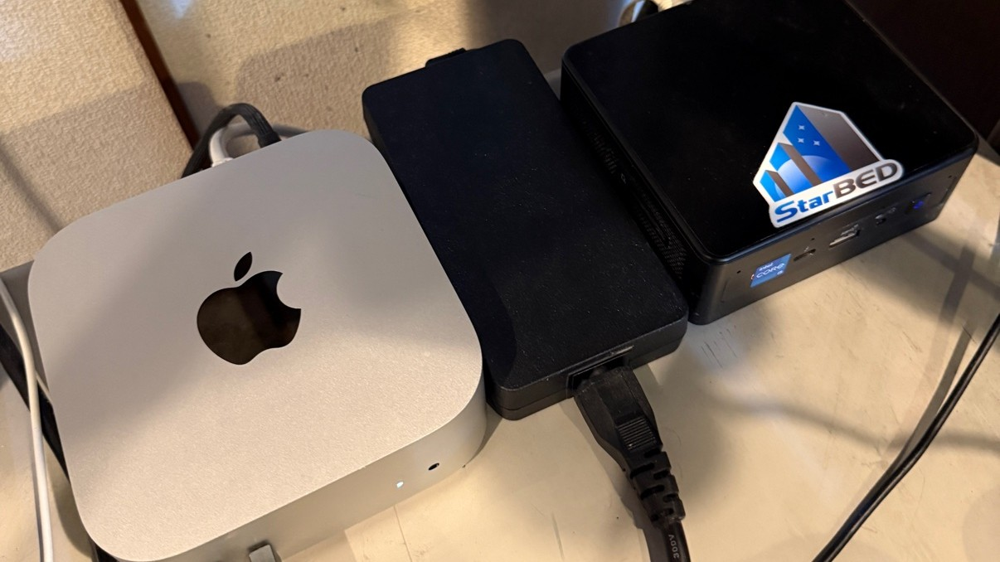

# 物理マシン2台でAIエージェントが働く自宅ラボを作った：できたことと残った壁

## 1. はじめに

週末の夜、自宅サーバーにSSHで接続します。サービスは動いています。でも、前回どこまで進めたのかが分かりません。AIに続きを頼んでも、作業の状態を引き継げないのです。

この記事は、そうした状況を変えるための構築記録です。目指したのは、サービスを起動するだけのラボではなく、**仕事と状態を受け渡せるラボ**です。物理デバイスは、Intel NUCとMac miniの2台です。

## 2. 構成

中心となるのはIntel NUC（Ubuntu）です。Docker Composeで自動化と監視の基盤を構築しています。解析用に、仮想NICを持たないQEMU/KVMのVMも用意しています。

もう1台の常駐ホストがMac mini（M4）です。OpenClawを導入し、そのエージェントからCodexとClaude Codeを呼び出せるようにしました。複数のAIの間で状態を共有するために、GitHubリポジトリ上の伝言板を使っています。

> - Intel NUC：n8n、GitHub情報の収集とレポート生成、Prometheus、Grafana、Uptime Kuma
> - 解析VM：REA、Ghidraによるオフライン解析実験
> - Mac mini：OpenClaw、Codex、Claude Code
> - 伝言板：複数AI間の状態共有（GitHubリポジトリ）

台数を増やせば分散できると思いがちですが、実際は置き場所が増えるだけです。状態を共有する場がないと、機械同士はつながりません。

## 3. 作ったもの

NUCでは、GitHub情報の収集からMarkdownレポートの生成、MCP経由での参照までを手動で実行し、確認しました。PrometheusとGrafanaについては、収集先から正常な応答があることを確認しています。暗号化バックアップと、隔離した環境での復元試験も実施しました。

Mac miniでは、OpenClawから両CLIを起動できることを確認しました。編集計画や短い応答の生成といった、限定的な作業まで進みました。専用のGitHub試験では、push、PR作成、マージまで成功しています。伝言板については、定期的に状態を投稿できることと、受信した本文を通常の会話で読めることを確認しました。

一度動けば毎回動くと思いがちですが、条件が変われば結果も変わります。次の3つは分けて確認します。

> - 定期実行の設定が済んでいること
> - 手動実行が成功すること
> - 必要な項目を全部取れたこと

## 4. 物理マシンならではの壁

最初の壁はSSHでした。SSHエージェントが多数の鍵を提示し、認証失敗回数の上限に達しました。キーボードの配列の違いにより、意図したとおりに入力できない問題も起きました。

次の壁は画面ロックです。ログイン後の画面ロックが遠隔操作の障害になりました。構築の最終段階でも発生しています。**SSHで入れることと、GUIを解除できることは別物**です。完全なヘッドレス運用ができるかどうかも、別に確認しました。

FileVaultと自動ログインはトレードオフの関係にあります。再起動後の復帰やスリープについても、個別の確認項目として残っています。クラウドの仮想マシンと違い、物理マシンでは「画面」と「電源」と「鍵」が、それぞれ別の壁になります。

SSHで接続できれば遠隔運用は完成だと思いがちですが、実際は画面ロック1つで止まります。接続できたことと、無人で運用できることは分けて確かめます。

## 5. ソフト側の壁と対処

### バックアップが止めたはずのサービスを起こす

夜間のバックアップ処理によって、意図的に停止していたOpen WebUIまで再起動してしまいました。以前の処理は、全スタックを停止し、その後すべて再開する仕組みだったためです。

処理前に動いていたスタックだけを停止・再開する方式に直しました。教訓は、バックアップの成功条件に「ファイルを作れた」だけでなく、**停止状態を保てた**ことも含めることです。

### 収集の再実行が、良いレポートを壊す

GitHubの無認証APIには利用回数の上限があります。同じ日に再収集したところ、先に作った詳しいレポートを、取得範囲の狭い結果で上書きしてしまいました。

保護の仕組みを、毎回内容から完全性を計算する方式に変えました。再実行すれば直るとは限りません。内容の薄い結果で上書きしてしまうこともあります。

### 結果が「不明」のとき、再試行しない

専用GitHub試験のPRは、GitHub側ではマージされていました。しかし、エージェント側では成功を確認できず、結果を「不明」と記録して停止しました。

ここでは再試行せず、外部の状態を確認しました。外部での変更が成功していても、結果を取得できなければ、エージェントには成功したかどうか分かりません。再試行によって二重に実行する方が、よほど危ない場面でした。

### 承認登録エラーは未解決

通常作業では、子セッションの承認登録時に `operator.approvals` が不足しているというエラーが出ます。Gitコマンドが実行される前に止まります。基準日時点で、この問題は未解決です。

GitHubの認証失敗や、対象リポジトリの権限不足が原因とは断定できません。管理画面の別の接続に権限があることも、失敗した接続に同じ権限がある証拠にはなりません。原因が分かるまでは、対象を絞って切り分けを進めます。

## 6. 注意点

受信した情報は信頼できないものとして扱います。伝言板に依頼が書かれていても、それだけで実行を許可することはありません。

監視についても、項目を分けて確認します。「入口が見えること」「必要な情報が揃うこと」「通知が届くこと」は、それぞれ別の確認です。解析ツールが終了コード0で終わっても、それだけで解析能力が十分だとは判断しません。

この記事で確認できたことは、限定的な範囲にとどまります。全サービスの現在の健全性や、任意のリポジトリでの自動開発、三者間の完全な自動往復については、まだ十分に確認できていません。

## 7. まとめ

感覚としては、8割方まで来ました。これは測定した成功率ではなく、残っている項目から見た主観です。

> - 承認登録エラーの切り分け
> - 解析VMの能力の受け入れ確認
> - 新しいバックアップの復元試験
> - Mac miniの無人運用の最終確認

起動するラボから、仕事と状態を受け渡せるラボへ。残りの壁は具体的になったので、1つずつ確認を続けます。

## 8. 参照

> - 構築レポート（本記事の根拠資料）：https://github.com/moruku36/home-ai-engineering-lab/blob/main/docs/home-lab-kurotchi-build-report-2026-11-08.ja.md
> - リポジトリ：https://github.com/moruku36/home-ai-engineering-lab
> - OpenClawの承認API定義（operator.approvalsの要否の確認）：https://github.com/openclaw/openclaw/blob/v2026.11.1/src/gateway/methods/core-descriptors.ts
