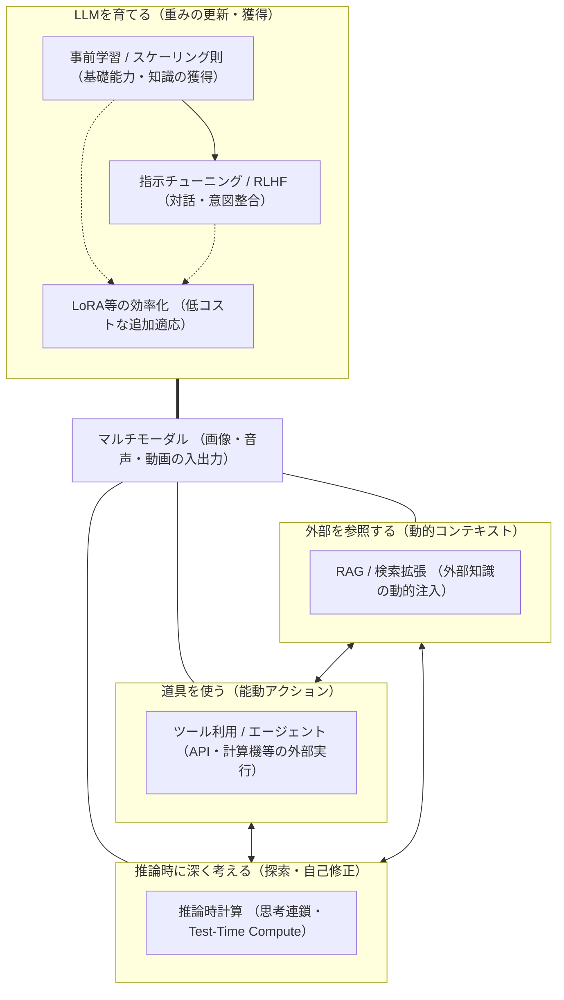

## 製品名より「何を変えた技術か」で整理する

LLMの新しい名前を覚えても、システムの中でどんな役割を担うのかが分からなければ、設計には結びつきません。そこで「LLM全体地図（2020–2026）」を学ぶ過程で集めた研究を、7つの転換点として整理し直しました。

これは2026年までの全成果を網羅した年表ではありません。2020〜2025年の代表研究を中心に、**学習する・情報を参照する・道具を使う・推論時に計算する**という役割の違いをつかむための学習メモです。各技術は一本道で置き換わったのではなく、組み合わせて使われます。

## 役割の違いを図で見る

線は組み合わせを考えるための関係を示します。全要素が必須という意味でも、歴史的な登場順でもありません。マルチモーダルの対応範囲はモデルによって異なります。図の草案はGeminiで生成し、HTML改行を除いて整えました。

## 1. 事前学習とスケーリング則：計算量をどう配分するか

Kaplanらは、モデル規模・データ量・学習計算量と損失の関係に、実験範囲内でべき乗則が見られることを報告しました。Chinchillaの研究は、一定の計算予算でモデル規模と学習トークン数の配分を見直しました。

「GPUを増やせば業務精度も必ず上がる」という法則ではありません。何を学習させ、どの評価で確かめるかを、計算資源と一緒に考える出発点です。

出典：[Scaling Laws（2020）](https://arxiv.org/abs/2001.08361)、[Chinchilla（2022）](https://arxiv.org/abs/2203.15556)

## 2. 指示チューニングと選好学習：指示に応えるよう調整する

次の単語を予測する能力と、利用者の意図に沿って応答する能力は同じではありません。InstructGPTは、模範回答による調整と人間のフィードバックを用いた強化学習を組み合わせました。DPOは、選好データからモデルを直接最適化する別の方法を示しました。

業務で使う際も、指示追従の改善と事実の正確さは別に評価する必要があります。プロンプト設計が不要になるわけではありません。

出典：[InstructGPT（2022）](https://arxiv.org/abs/2203.02155)、[DPO（2023）](https://arxiv.org/abs/2305.18290)

## 3. LoRA・QLoRA：モデル適応のメモリ負担を減らす

LoRAは事前学習済みの重みを固定し、小さな低ランク行列を学習します。QLoRAは量子化したモデルとLoRAを組み合わせ、論文の実験では65Bモデルを単一48GB GPUで微調整しました。

ここでの48GBは実験条件付きの結果です。必要メモリはモデルや系列長などで変わります。公開された重みを利用する場合も、ライセンスや運用条件の確認は別途必要です。

出典：[LoRA（2021）](https://arxiv.org/abs/2106.09685)、[QLoRA（2023）](https://arxiv.org/abs/2305.14314)

## 4. RAG：モデルの外にある情報を参照する

RAGは、モデルの重みに蓄えた知識に加え、検索した文書を生成に利用する考え方です。モデルの再学習と、参照文書の更新を分けて考えられます。

ただし、誤った文書を検索したり、正しい文書を読み違えたりする可能性は残ります。文書の更新、アクセス権、検索品質、回答と根拠の対応を確かめることが運用の課題になります。長い入力を受け取れることと、必要な根拠を適切に利用できることも別です。

出典：[Retrieval-Augmented Generation（2020）](https://arxiv.org/abs/2005.11401)

## 5. マルチモーダル：画像と言葉を結びつける

CLIPは画像とテキストの対応から表現を学ぶ研究です。LLaVAは視覚エンコーダーと言語モデルを接続し、画像を含む指示への応答を学習しました。

文章だけでは伝えにくい図や画面も入力候補になります。ただし、画像を扱えるモデルが、細かい文字や図の関係まで常に正確に読めるとは限りません。用途に応じた確認が必要です。

出典：[CLIP（2021）](https://arxiv.org/abs/2103.00020)、[LLaVA（2023）](https://arxiv.org/abs/2304.08485)

## 6. エージェント：応答に加えて道具を使う

ReActは、推論の記述と行動を交互に生成し、外部から得た結果を次の判断へ反映する方法です。出力を読むだけの利用から、検索やツール操作を含む利用へ、設計対象が広がります。

関連するCoT promptingには推論例を示す方法があり、Zero-shot CoTは例を示さず短い指示を加える方法です。両者を同じ手法として扱わないように整理しました。

実務への接続としては、道具ごとの権限、実行結果の検証、失敗時の停止条件を考えます。全エージェントに特定のマイクロVM製品が必須という意味ではありません。

出典：[ReAct（2022）](https://arxiv.org/abs/2210.03629)、[CoT（2022）](https://arxiv.org/abs/2201.11903)、[Zero-shot CoT（2022）](https://arxiv.org/abs/2205.11916)

## 7. 推論時計算：回答時の計算予算も設計する

Snellらは、検証器を使った探索など、推論時の計算配分を検討しました。効果は問題の難しさや方法に依存します。DeepSeek-R1の研究では、事前の教師あり微調整を行わないR1-Zeroと、コールドスタートデータなどを取り入れたR1を区別する必要があります。

考える時間や候補を増やすと、遅延や費用も変わります。事前学習が不要になった、長く生成すれば必ず正解する、と読むのは不適切です。業務では精度・待ち時間・費用の釣り合いを確かめます。

出典：[Test-Time Compute Scaling（2024）](https://arxiv.org/abs/2408.03314)、[DeepSeek-R1（2025）](https://arxiv.org/abs/2501.12948)

## 記事に戻して、次の問いを作る

この整理を通じて、モデル自体を調整する方法、外部情報を渡す方法、ツールを動かす方法を分けて考えやすくなりました。

次に深掘りしたいのは「自分の用途では、どの部分が精度や費用の制約になっているか」です。出典に戻りながら文章と図で説明し直すことで、理解の抜けを次の学習につなげます。
