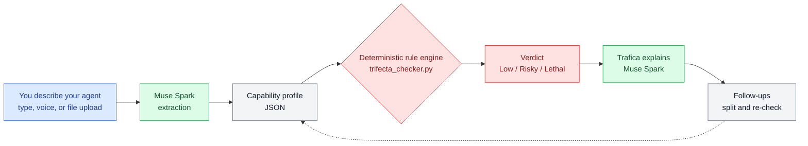

この記事は、Metaのグローバルハッカソンに日本からソロで参加した前半の記録です。

## 1. はじめに
大会は Meta Global AI Developer Hackathon です。会期は2026-10-26 12:00〜11-04 21:00 ETで、完全オンライン開催です。
筆者は Team_moruku36 として Indie トラックにソロで参加しています。この記事では大会の概要と世界の参加者の様子、そして自作の診断ツールについて伝えます。

## 2. Metaはなぜこのハッカソンを開くのか
Meta は Connect のまとめで「To help developers put these models to work right away（開発者がすぐモデルを使い始められるように）」と述べています。
Meta Model API や Muse Code、オープンウェイトのモデルを、無料の Model API クレジット付きで使える形にしました。選出された参加者には Meta Model API のクレジット $150 分が配られました（公式SNSで確認）。
Cerebral Valley の大会ページの呼びかけは「Come and build the future of superintelligence.」です。パートナーの Baseten、Modal、Fireworks もオープンウェイトを動かすためのクレジットを提供しています。

## 3. 公式ライブセッションで発表されたこと
期間中はキックオフとハンズオンのライブセッションが配信されました。公式発表の内容を整理します。

キックオフ司会は Cerebral Valley の Ivan Porollo、Meta 側は Model API エンジニアリングディレクターの Saurabh でした。
Meta Superintelligence Labs の狙いは、アイデアから動くプロダクトまでの時間を縮めることです。選出された参加者には Model API の無料クレジット $150 が配られました。
道具として Muse Spark / Wonder、Muse Code、Muse Image、Muse Voice Transcribe が紹介され、オープンウェイトの Muse Glimmer / Muse Spark Open はパートナー経由で提供されます。
パートナーのクレジットは Baseten が $100（最大 2M tokens/min）、Modal が先着1,000チームに $100、Fireworks もクレジットを提供しています。

ルールは、制作期間10日間（締切 11月4日 21:00 ET）、トラックは Indie / Startups、テーマは Build for Your World / Push the Frontier です。新規制作のみ、リポジトリは公開が条件です。
賞金総額は $1M（トラック分 $950K＋ボーナス $50K）です。キックオフではボーナスカテゴリとして Most Viral、Best build on Meta open weights、Community Vote、Best Agentic use case、Best Creative build が挙げられました。
審査は3段階で、通過可否のスクリーニング→ルーブリック採点（Impact を最重視）→11月9日のライブ決勝（各トラック上位5件）です。3分のデモ動画が審査の大きな部分を占めるため、提出フォームの早期確認が勧められました。

ハンズオン Agents 101/102 も配信されました。Part 1（Suraj）は Muse Code と Meta Model API で、文書・スキャン・チャートを横断する法律調査エージェントを作る回でした。
Part 2（Yash Khare、Meta のパートナーエンジニア）は「Best Practices for Verifiable Agents」で、検証レイヤーの追加がテーマです。
要点は、チェックをツール内に組み込みエージェントが回避できない形にすることです。決定論的チェックを先に置き、LLM-as-judge は主張の正しさの判定だけに使います。最終ゲートは人間のサインオフです。
デモでは、前回セッションで作ったメモが検証に不合格となりました。
筆者の三要素チェックも同じ型で作っており、この一致を提出物の design grounding として盛り込みました。

## 4. 世界の参加者の様子
公開された参加者発信から、作品の例を3つ紹介します。いずれも全体の傾向ではなく、個別の事例としてご覧ください。
1つ目は TokenTrim で、コーディング課題のベンチマーク作品です https://nandigamharikrishna.substack.com/p/i-got-into-metas-1m-global-ai-developer
2つ目はケニア・モンバサの 90+ / Opesi Mansion です。高齢者向けに、写真から SAM 3.1 と Muse Spark で eBay / Facebook Marketplace への出品を自動化します https://www.opesimansion.com/blog/building-90-plus-at-meta-hackathon/
3つ目は Keyframe です。部屋の写真から脱出ゲームを生成し、Muse Spark のエージェント群と SAM 3.1、Muse Image、音声を組み合わせています https://github.com/lutic1/meta-hackathon-2026
ほかに YourMove / Joshua Jenks は、Indie 審査が「実際に動くか」を見る点を評価しています https://www.yourmove.run/blog/meta-global-ai-developer-hackathon-yourmove/ ハンガリーの参加者のブログも公開されています https://vibecoderslife.com/post/meta-ai-developer-hackathon-2026
困難の声も単独事例として残されています。開催初日に「API クレジット待ちで、エージェント型コーディングツールへのアクセスがない」と話す YouTube 投稿がありました。
Keyframe のリポジトリには、キックオフまで実 API にアクセスできずモックで開発していたと書かれています。二次ガイドでは、参加資格がある国でも国によって Meta Model API 自体が使えない場合があると指摘されています。
X（旧Twitter）上の声は直接たどるのが難しく、全体の sentiment は断定できません。日本語の参加者発信は調査では見つかりませんでした。

## 5. 自分の作品：三要素チェックの仕組み
作品は「三要素チェック（Trifecta Checker）」です。AIエージェントの安全診断ツールとして作りました。
診断の考え方は Simon Willison の lethal trifecta に基づきます。①私的データへのアクセス、②信頼できない入力、③外部への送信の3要素がそろうと危険（Lethal）と判定します。
**判定は LLM に任せず、決定的なルールエンジンが行います。** 同じ入力なら必ず同じ判定になる点が特徴です。
Muse Spark（Meta Model API）は、説明文から構造化プロフィールへの抽出と、判定のやさしい言葉への言い換え、追加の対話だけを担当します。役割を分けることで、再現性と分かりやすさを両立しました。
抽出は閉じた語彙で検証します。語彙から外れたら1回だけ修復を試み、だめなら失敗として返します。

対話はキャラクター Trafica と話す形式です。英語・日本語・中国語・ヒンディー語・スペイン語の5言語に対応しました。

## 6. 使い方
公開デモはこちらです https://meta-global-ai-hackathon-trifecta-c.vercel.app/
エージェントの説明文や MCP 設定 JSON を読み込ませると診断が始まります。設定の貼り付けだけで試せる形にしています。
公開に先立ち、API に入力長上限を実装しました。本文64KB、判定用テキスト8,000字などが上限です。超えたら LLM を呼ばずに返します。
IP ごとの簡易レート制限も用意しました。同一インスタンス内 60回/分目安のベストエフォートで、全インスタンス共通の保証はありません。
デモは無料クレジット上で動いています。入力内容がサービス改善に使われる可能性があるため、サンプル文での利用を案内しています。

## 7. 前半を終えて
本体は完成し、残り作業はデモ動画と提出のみです。仕組みの検証と公開用ガードまで終えられた点に手応えを感じています。
今回の大会は完全オンラインです。提出締切は日本時間11月5日 11:00で、審査は11/4〜8、決勝・発表は11月9日のライブ決勝です。
賞金総額は $1M です。公開ルールの要約では Indie 計 $400k、Startup 計 $550k、ボーナス最大 $50k とされています。
配点は Impact 30% / Meta AI の活用 25% / デモ 25% / 技術 20% です。動くデモの重みが大きい点が印象に残りました。

## 8. 注意点
参加枠の上限は20,000人と公表されています。ただし実際の参加者数は公表されていません。
世界の参加者の紹介は、見つかった公開発信の小さなサンプルです。全体の傾向とは言えません。
レート制限は同一インスタンス内の目安です。強い保証がある仕組みではありません。
判定はヒューリスティックな診断です。安全性を証明するものではなく、見落としもあり得ます。

## 9. まとめ
前半では大会の概要を整理し、自作の三要素チェックを公開まで進めました。判定の再現性と使いやすさの両立を目指した形です。
後半はデモ動画と提出を仕上げ、審査で伝わる形に整えます。公開デモをサンプル文でぜひ試してみてください https://meta-global-ai-hackathon-trifecta-c.vercel.app/
