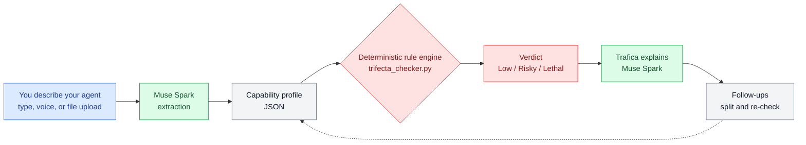

この記事は、Metaのグローバルハッカソンに日本からソロで参加してみた記録です。先に結論を言うと、参加してみたらとても楽しかったです。

## 1. はじめに
大会は Meta Global AI Developer Hackathon。完全オンラインで、開催期間は10月26日から11月4日（ET）です。賞金総額は $1M。筆者は日本からソロで参加しています。
しかも一人ではありません。相棒のAIエージェントと一緒に開発する、ちょっと変わった参加のしかたです。
会期中は、世界中の開発者が一斉にものを作ります。その空気に触れるだけで、十分に参加する価値がありました。

## 2. 世界とつながっている感覚
何より楽しいのは、世界とつながっている感覚です。参加者のタイムゾーンはバラバラで、東アジアが日中に動いている一方で、こちらが寝ている間に米国や欧州のチャットが進んでいます。
朝起きて Discord を開くと、夜の間に誰かの作品が進んでいたり、議論が白熱していたりします。正直なところ、筆者は Discord にほとんど参加できていません。眺めているだけでも楽しいのです。
作品もさまざまです。部屋の写真から脱出ゲームを作る人、高齢者の出品作業を自動化する人。世界中の「作りたい」が一斉に並ぶ光景は、見ているだけで刺激になります。自分も何か作らなければ、と自然に背中を押されます。国も言語も違うのに、ものづくりへの熱量はどこも同じなのだと感じます。

## 3. 公式セッションとオフィスアワー
キックオフでは、世界中から集まった参加者に向けて、大会の進め方と道具立てが一気に紹介されました。ハンズオンのライブセッションも配信されています。
ハンズオンでは、エージェントに「検証レイヤー」を組み込む話が印象に残りました。チェックを回避できない形で道具に埋め込む、という考え方です。
個人的に一番ありがたいのはオフィスアワーです。Meta の技術者に直接質問できる場が開かれていて、グローバルな大会なのに距離を感じません。こういう「聞ける場」があると、独学では届かないところまで手を伸ばせます。

## 4. 自分の作品
筆者の作品は「三要素チェック（Trifecta Checker）」です。AIエージェントの構成を読み取り、危険な組み合わせになっていないかを診断します。
判定は LLM の気分に任せず、決定的なルールエンジンで行います。同じ入力なら必ず同じ判定になる、というのがこだわりです。
案内役はキャラクターの Trafica です。公開デモはこちらです。https://meta-global-ai-hackathon-trifecta-c.vercel.app/

なお、判定はヒューリスティックな目安で、安全性を証明するものではありません。

## 5. まとめ
結果は正直、あまり気にしていません。面白いものを作って「これ作ったんだ」と見せ合える。それだけで十分に楽しい大会です。
デモは公開中です。よかったら触ってみてください。提出締切は日本時間11月5日11:00で、残りはデモ動画と提出を仕上げるだけです。後半も楽しみながら走り切ります。
