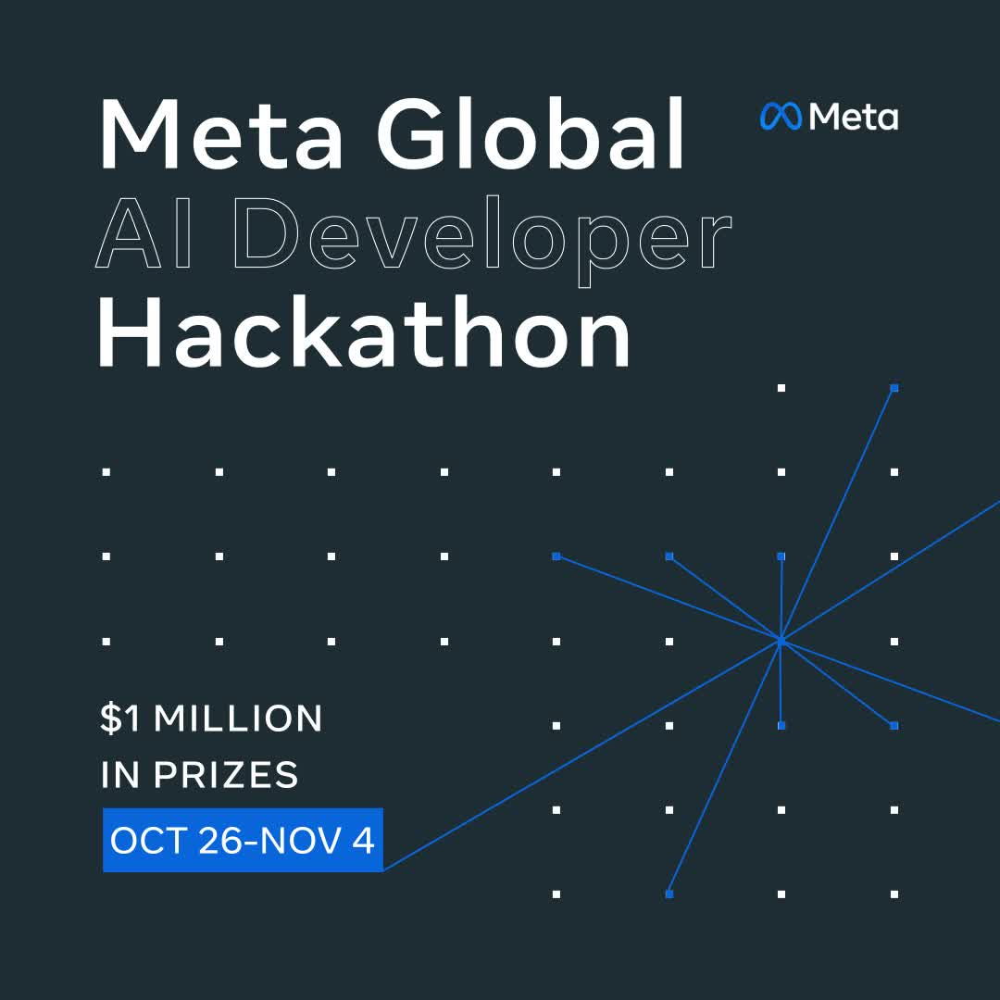

# MetaのAIハッカソンが終わった。5,367作品の頂点と、入賞を逃した自分の気づき

入賞は逃しましたが、上位作の多くには**検証の仕組み**という共通点がありました。

## 1. はじめに

この記事はMeta Global AI Developer Hackathonの結果報告の後編です。

前編では参加の経緯と提出作について書きました。

後編ではクロージングで発表された受賞作を紹介します。

## 2. クロージングで分かったこと

応募者は約33,000〜40,000人、参加者は20,000人にのぼりました。

提出数は5,367プロジェクトで、賞金総額は100万ドル超でした。

クロージングではファイナリストがピッチを行い、審査員がその場でレビューしました。

審議を経てIndieとStartupの各トラックの受賞作と、特別賞が発表されました。

賞金10,000ドルのCommunity Voteだけはまだ投票が続いています。

勝者は2026-11-16に発表される予定です。

## 3. Indieトラックの受賞作

Indieトラックは個人や小規模チームの部門です。

上位5作はいずれも実世界との接点が強い内容でした。

> 🥇 ControlAnythingはQuest 3のARを使う操作支援アプリです。
>
> 実物のデバイスをピンチすると、その場で操作用のコネクタを自動生成します。

> 🥈 Gatekeeperはnpmの新着パッケージを監視する検査ツールです。
>
> 公開リストより約1日早くマルウェアを検知し、証拠の引用を必須にしています。

> 🥉 David Barryは地下室の活用を判定する住宅診断アプリです。
>
> スマホで撮影するだけで、合法的にセカンドホームにできるかどうかと、その方法が分かります。

> 4位 Aurora（Nemesis）はロボット訓練のための物理シミュレーション生成ツールです。
>
> 自然言語や画像から環境を作り、脚ロボットを再訓練できます。

> 5位 Video2URDFは動画からロボット用モデルを作る変換ツールです。
>
> 関節を持つ物体の動画からURDFを自動生成し、開発の手間を減らします。

## 4. Startupトラックの受賞作

Startupトラックは事業化を見据えたチームの部門です。

現場や製造など具体的な業務に踏み込んだ作品が選ばれました。

> 🥇 Consai（Punchwalk）は建設現場向けの不具合管理ツールです。
>
> 音声と写真から検証済みのパンチリストを作成し、手戻りを減らします。

> 🥈 Formwrightはプロンプトから実機を作るハードウェア設計ツールです。
>
> 回路や基板、筐体、ファームウェアまで生成し、製造発注につなげられます。

> 🥉 ORCAは3Dモデル同士の干渉を扱う設計支援ツールです。
>
> 干渉を検出するだけでなく、幾何学的に証明した修正案を提示します。

> 4位 Voluma Bioは研究用の3D計測ツールです。
>
> マイクロCTの画像から3D計測の結果を自動生成し、解析を助けます。

> 5位 Kroonen AI（Glimmer Scope）はモデルの解釈可能性を高めるツールです。
>
> LLMの内部概念を可視化し、ダイヤル操作で挙動を確認できます。

## 5. 特別賞

特別賞は技術や創造性の観点で優れた作品に贈られました。

検証の仕組みを組み込んだ作品も選ばれています。

> Most ViralのAdrianのPlaytest Agentはゲームのテスト支援ツールです。
>
> スクリーンショットだけでゲームをプレイし、リプレイ検証付きでバグを報告します。

> Best Build on Meta Open WeightsのTessaは天文データ解析ツールです。
>
> NASAのTESSデータから系外惑星候補を自律的に探索し、新規候補8件を見つけました。

> Best Agenticのoqedはコード最適化ツールです。
>
> LLMに高速なアセンブリコードを書かせ、厳格な検証を通ったものだけを採用します。

> Best CreativeのTeam SynthexisのsynthexisはWebカメラを使う楽器です。
>
> 手や顔の動きでシンセサイザーを演奏でき、直感的な表現が可能です。

## 6. 自分の結果と気づき

私はソロでIndieトラックにTrifecta Checkerを提出しました。

AIの出力を3つの要素で検証するチェックアプリでした。

結果は入賞なしで、ファイナリストにも残りませんでした。

落選は残念でしたが、上位作を見て納得する部分が多くありました。

多くの作品に共通していたのは、**検証の仕組み**を作品に組み込んでいた点です。

証拠の引用や検証ゲート、幾何学的証明、リプレイ検証などが組み込まれていました。

AIに作らせるだけではなく、結果をどう信頼できるものにするかが問われていると感じました。

もう一つは実世界への踏み込みの強さでした。

建設現場や地下室、ロボット、研究用画像など、対象が具体的でした。

私の作品は検証の考え方が近かったと思います。

一方で、対象領域と検証の結びつきが弱かったと感じています。

## 7. 注意点

受賞内容はクロージング時点の発表に基づいています。

Community Voteはまだ確定しておらず、変更の可能性があります。

各作品の詳細はギャラリーの記載が正式情報になります。

本記事の紹介は要点を絞った2〜3文の要約です。

## 8. まとめ

上位作を見て、派手さだけでなく信頼の作り方が重視されていると感じました。

**検証の仕組み**と現場への踏み込みが今後の指針になります。

私は次の制作で対象を一つに絞り、検証まで作り込みたいです。

## 参照

受賞作の公式ギャラリーページ（Cerebral Valley）

- ControlAnything: https://cerebralvalley.ai/e/meta-ai-developer-hackathon/hackathon/gallery/3441
- Gatekeeper: https://cerebralvalley.ai/e/meta-ai-developer-hackathon/hackathon/gallery/1193
- David Barry: https://cerebralvalley.ai/e/meta-ai-developer-hackathon/hackathon/gallery/4356
- Aurora（Nemesis）: https://cerebralvalley.ai/e/meta-ai-developer-hackathon/hackathon/gallery/2723
- Video2URDF: https://cerebralvalley.ai/e/meta-ai-developer-hackathon/hackathon/gallery/2050
- Consai（Punchwalk）: https://cerebralvalley.ai/e/meta-ai-developer-hackathon/hackathon/gallery/4672
- Formwright: https://cerebralvalley.ai/e/meta-ai-developer-hackathon/hackathon/gallery/3836
- ORCA by IssueLab: https://cerebralvalley.ai/e/meta-ai-developer-hackathon/hackathon/gallery/3002
- Voluma Bio: https://cerebralvalley.ai/e/meta-ai-developer-hackathon/hackathon/gallery/4991
- Kroonen AI（Glimmer Scope）: https://cerebralvalley.ai/e/meta-ai-developer-hackathon/hackathon/gallery/2162
- Adrian（Playtest Agent）: https://cerebralvalley.ai/e/meta-ai-developer-hackathon/hackathon/gallery/531
- Tessa: https://cerebralvalley.ai/e/meta-ai-developer-hackathon/hackathon/gallery/2303
- oqed: https://cerebralvalley.ai/e/meta-ai-developer-hackathon/hackathon/gallery/149
- Team Synthexis（synthexis）: https://cerebralvalley.ai/e/meta-ai-developer-hackathon/hackathon/gallery/5090
