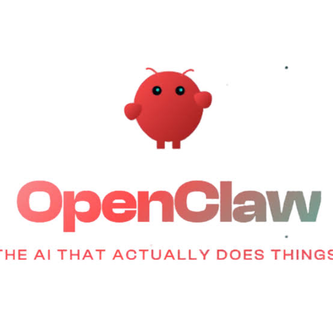

# OpenClawを入れて分かった、AI Agentの境界を決める4つのポイント

公式がうたう「すぐ使える」状態から、安全に運用するための境界を一つずつ決めました。

## 1. はじめに

自宅のAIラボにOpenClawを入れました。公式サイトでは「入れればすぐ使える」とうたっていますが、そのままでは運用できませんでした。
できることを増やすたびに境界を決め直し、うまくいった範囲だけを根拠とともに記録しました。この記事では、その作業を整理します。
なお、末尾の参照先の記録では、OpenClawのことを筆者が付けた呼び名「クロッチ」と表記しています。

## 2. 隔離と使いやすさの境界を決めた

最初はChatGPT側のAIエージェントの提案に従い、隔離を優先しました。OpenClawをDockerの隔離環境に置き、資格情報を見せない設計にしました。
しかし、隔離環境の中からは開発CLIをそのまま使えず、作業のたびに別の手段が必要になりました。手間が増え、作業が回らなくなったのです。
そこで私自身の判断で、作業用エージェントをMac上で直接実行する形に切り替えました。

> 実行環境はMac上に置く
> ブラウザは別の環境で操作する
> 認証情報の管理は別に考える

実行環境、ブラウザ、認証を分けて考えました。無理なく使い続けられる構成でなければ、安全でも運用は回りません。

## 3. 認証と認可の境界を分けた

GitHubへのpushやPR作成はできました。それでも通常の作業は途中で止まりました。子セッションへの承認が足りなかったのです。
ログインできていることと、操作を許可されていることは別でした。そこで認証、操作権限、承認要求を分け、実行と結果の回収も切り分けました。
管理画面の公開範囲はループバックに限定し、ブラウザ用コンテナにはDockerの制御口を渡していません。
機能は公開ページや架空データを使って小さく確認しました。2026年11月9日には実作業ブランチのpushとCIの成功を確認しましたが、何でもできるようになったわけではありません。

> 認証は誰かを示す
> 操作権限は操作できる範囲を示す
> 承認要求はその都度の許可を求める

動作を確認できた範囲だけで運用する方針にしました。

## 4. 定期ジョブと通常会話の境界をつないだ

MetaのMuse、ChatGPT、OpenClawを一緒に使っています。設計思想の異なる3つのAIエージェントです。
GitHubリポジトリ上の伝言板で定期タスクの状況を共有し、エージェント同士が助け合うマルチAIワークフローを運用しています。
定期処理では受信箱を読めました。しかし、その内容を通常の会話でそのまま使えるわけではありませんでした。
そこで受信した本文と出典をたどれる経路を作り、読み戻して一致を確認する運用にしました。受信した文章をそのまま実行の許可にはしていません。

状態の共有は非機密の要約に絞り、送信先、頻度、重複も制限しています。配送まわりはまだ完全ではありません。
設計も方針も違うもの同士を同じ基盤でつなぐのは難しいです。

> 受信箱の中身を確認する
> 本文と出典を会話からたどる
> 要約だけを共有する

受信箱を読めることと、内容が会話に届くことは別だと考えて運用しています。

## 5. 課金経路の境界を分けた

当初は従量制のOpenAI APIで動いていました。1日で約15ドルの課金が発生し、このままでは続けられませんでした。
ChatGPT側のAIエージェントの提案で経路を変え、Codexのサブスクリプションに紐づく経路へ移しました。その際、モデルと思考レベルは変えていません。
対象エージェントのモデルのフォールバック候補を空にしました。サブスクリプションが使えない場合は停止する構成です。有料APIへ自動で切り戻らないようにしました。

> 普段はサブスクリプション経路を使う
> 使えない場合は止まる
> 従量制への切り戻しはしない

使えない場合に停止する設計が、意図しない課金を防ぐと考えました。

## 6. 注意点

完全な自律運用、認証セッションの完全な分離、再起動後の安定性はいずれも未検証です。
サブスクリプションの上限到達時の動作は未試験です。そのため、API費用がゼロになるとは言えず、節約効果も実測できていません。
この記録は既存の公開構築記録を照らし合わせて整理したものです。今回新たに実機試験はしていません。

## 7. まとめ

境界を一つずつ決め、成功した範囲だけを記録しました。運用はまだ途中ですが、進め方は見えてきました。

## 今後の展望

11月13日にNVIDIAのセミナーでOpenShellを知りました。OpenShellは、NVIDIAのエージェント向け設計集NemoClawに含まれる実行基盤です。ポリシーでエージェントの動きを制御し、サンドボックス内で動かします。NemoClawには、OpenClawのエージェントをそのまま動かすためのブループリントも用意されています。

現在のOpenClawの運用では、設定と運用上のルールで境界を保っています。ここにOpenShellを組み合わせれば、実行基盤側で境界を強制できる可能性があります。エンタープライズレベルの安全性を備えたAI AgentのOSSを目指し、今後の実装予定に加えました。

まだ構想段階で、検証はこれからです。

## 参照
- 11月6日 OpenClaw／クロッチ導入・検証記録 https://github.com/moruku36/home-ai-engineering-lab/blob/main/docs/openclaw-status-2026-11-06.ja.md
- 11月8日 ホームラボとクロッチの構築レポート https://github.com/moruku36/home-ai-engineering-lab/blob/main/docs/home-lab-kurotchi-build-report-2026-11-08.ja.md
- 11月9日 クロッチの改善記録 https://github.com/moruku36/home-ai-engineering-lab/blob/main/docs/kurotchi-improvements-2026-11-09.ja.md
- 11月10日 ラウンジ復旧と Codex サブスク切替 https://github.com/moruku36/home-ai-engineering-lab/blob/47d3068d86db54499368602d6b3d28a7d3569e3b/docs/kurotchi-lounge-codex-cutover-2026-11-10.ja.md
- NVIDIA NemoClaw（OpenShell） https://www.nvidia.com/en-us/ai/nemoclaw/
