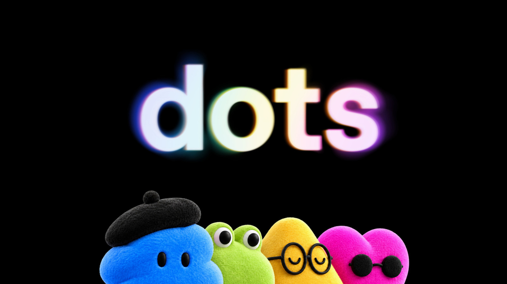

# Windowsでdotsが重くなる問題を観察した

## 1. はじめに

Windowsで同じdotsとの会話を続けていると、画面操作の反映が次第に遅くなった。本記事はその観察記録である。

ここでいうdotsは、OpenAIの環境で常時稼働している私専用のAIエージェントで、依頼した作業を継続的に進めてくれる相手のことである。

ここで扱うのは、UIの入力・描画・会話切替の遅延である。dotsはクラウド側で動く常時稼働のエージェントであり、会話そのものは手元のPCの外で進んでいる。AIが回答を生成する時間や、dotsが依頼された作業を終えるまでの時間と、手元の画面操作の遅さは分けて考える必要がある。本記事で「重い」と言うのは、後者の操作遅延のことである。

## 2. 症状

遅くなったのは、次のような操作である。

- 文字を入力してから画面に反映されるまで
- 送信操作やボタンの反映
- スクロールや画面の更新
- 過去の会話の読み込みや切替

体感では、操作のたびに1〜3秒ほど待つ場面もあった（いずれも測定値ではなく体感である）。同じ会話を使い続けるほど重くなる傾向があった。一方、新しく始めた通常チャットでは、この遅さは感じなかった。一度かなり速くなることもあったが、その後また再発した。

## 3. 環境

- 端末はWindows PC、搭載メモリは32GB
- アプリでもブラウザでも、同じdotsの会話では遅延が残った
- 同じPCでも、メモ帳や新しく始めた通常チャットは体感では速かった

ただし、メモ帳や新規の通常チャットが体感で速かったことだけで、PC全体の問題を除外できたわけではない。

使用しているアプリやOSの正確な版番号は取得できていない。遅延の定量的な計測も行っておらず、原因は特定できていない。

## 4. 試したこと

次を試したが、持続的な改善は確認できなかった。

- 表示まわりの対応：アプリ内の設定変更は試したが、持続的な改善は確認できていない。Windows側については、透明効果とアニメーション効果がOffであることを確認した（変更前の状態は不明）
- タブ整理やブラウザ終了などのクリーンアップ：メモリ使用率は下がったが、同じ会話の遅延は残った
- アプリの閉じ開きと再起動：朝に一度かなり速くなったことがあったが、それはWindows Updateと再起動の後で、表示設定の変更より前の出来事だった。午後に再起動した後の効果は確認できていない
- 別のブラウザで同じdotsを開く：大きな改善は感じられなかった

これらはいずれも組み合わせて行っているため、個々の効果は切り分けられていない。当日の一時的な改善は表示まわりの対応より前だったので、その効果とは言えない。

なお、会話への入力をiPhoneから行うと体感では速く感じられたため、PCで作業しながら会話入力だけiPhoneに分ける、という運用案を考えている。あくまで比較した体感に基づくもので、改善を実測したわけではない。

## 5. 現在の状況

公開されているIssueにも、「同じ会話や長時間の使用で操作が重くなる」という類似した報告が複数上がっている。関連する公開情報は次のとおりである。

- Issue一覧：https://github.com/openai/codex/issues
- Issue #38547：https://github.com/openai/codex/issues/38547 — Contributorが特定の一因への対処を対象版で説明し、Closedになっている
- Issue #20214：https://github.com/openai/codex/issues/20214 — Contributorが長時間使用時の停滞の一因への修正を説明している。その後も改善と残存の両方の投稿がある
- PR #40672：https://github.com/openai/codex/pull/40672 — 関連するコード変更がmainにマージされている

ただし、これらはいずれも個別の原因への対処の説明であり、すべての症状が直ったことや、企業としての保証ではない。マージされた変更が、すべての配布経路に反映済みとも限らない。

自分の事例については、OpenAIのサポートへ報告し、受付を確認した。ただし、担当者からの返信や原因の認定、修正の予定は確認できておらず、現在は対応をお願いしている状況である。自分の事例が公開Issueのどれと同じ原因なのかも分かっていない。

調査整理日は2026年11月2日（JST）、公開情報の確認基準は2026年11月1日（UTC）である。

## 6. まとめ

- Windowsで同じdotsの会話を続けると、入力・描画・会話切替の操作遅延が残った
- 設定変更やクリーンアップ、再起動などを試したが、持続的な改善は確認できなかった
- 原因は特定できておらず、サポートへ報告して対応をお願いしている段階である

## 7. 追記（2026年11月13日）

2026年11月13日、OpenAIはChatGPT公式アカウントの投稿で、dotsのアップデートを発表した。内容は次のとおりである。

・応答の高速化　返信が速くなった
・専門用語の削減　説明が分かりやすくなった
・フォローの改善　依頼した作業の続きを進めたり、確認したりする際のフォローが手厚くなった
・カスタム指示への対応　会話の中で直接指示できるほか、モバイルでは「カスタマイズ ＞ Behavior」、Webとデスクトップではdotのメニューから、指示とルールを設定できる

筆者の環境では、このアップデートの後、操作が体感としてかなり軽くなった。ただし、本記事の主題である「同じ会話を続けると操作が重くなる」という問題が解消したかどうかは、使い続けてみないと判断できない。計測したわけではないため、現時点では体感としての記録にとどめる。

出典：OpenAI ChatGPT公式アカウントの投稿（2026年11月13日）
